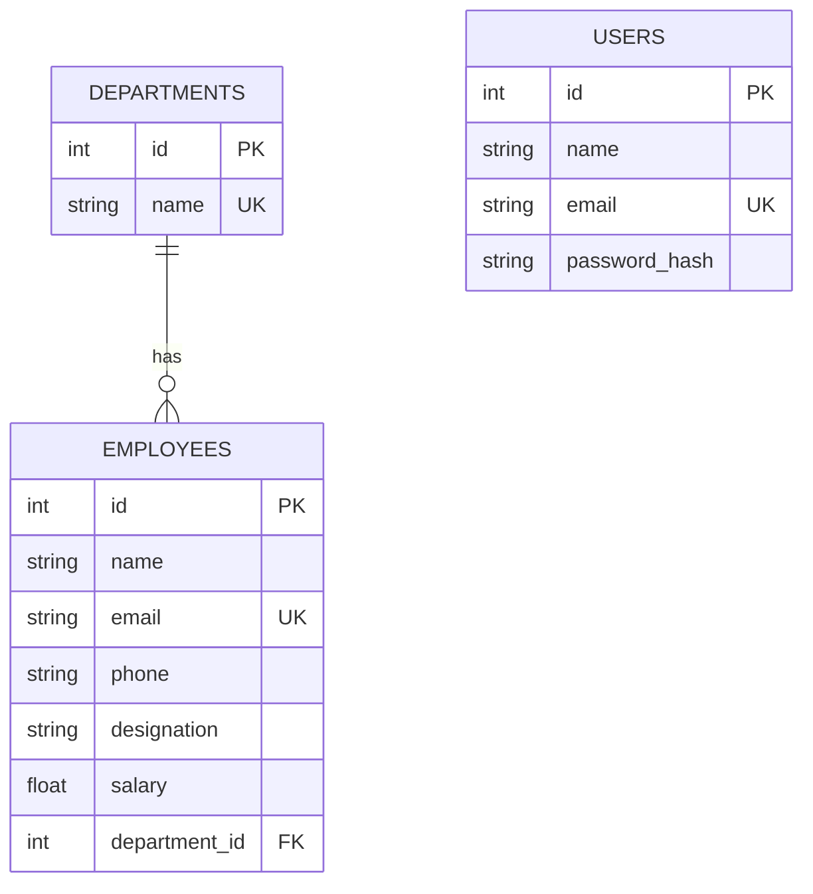

# Employee Management System

A RESTful Employee Management System built using **Python, Flask, MySQL, and SQLAlchemy**. The application provides secure authentication and APIs to manage employees and departments, with JWT-based authorization, input validation, error handling, and database migrations.

## Features

- **JWT Authentication:** User registration and login with securely hashed passwords.
- **Employee Management:** Create, retrieve, update, and delete employee records.
- **Department Management:** Manage departments and their associated employees.
- **Database Integration:** MySQL database using Flask-SQLAlchemy and SQLAlchemy ORM.
- **Input Validation:** Validates required fields, email addresses, salaries, and department references.
- **Error Handling:** Handles invalid requests, duplicate records, missing resources, and database errors.
- **Database Migrations:** Flask-Migrate and Alembic for version-controlled schema changes.
- **Automated Testing:** Pytest test suite with 99% code coverage.

## Technology Stack

| Category | Technologies |
|---|---|
| Language | Python |
| Backend Framework | Flask |
| Database | MySQL |
| ORM | Flask-SQLAlchemy, SQLAlchemy |
| Authentication | Flask-JWT-Extended |
| Database Migrations | Flask-Migrate, Alembic |
| Validation | Email Validator |
| Testing | Pytest, Pytest-Cov |
| Version Control | Git, GitHub |

## Project Structure

```text
employee_management_system/
│
├── app/
│   ├── models/
│   │   ├── user.py
│   │   ├── employee.py
│   │   └── department.py
│   │
│   ├── routes/
│   │   ├── auth.py
│   │   ├── employees.py
│   │   └── departments.py
│   │
│   ├── utils/
│   ├── config.py
│   └── __init__.py
│
├── migrations/
│   └── versions/
│
├── tests/
│   ├── conftest.py
│   ├── test_auth.py
│   ├── test_employees.py
│   ├── test_departments.py
│   └── test_edge_cases.py
│
├── docs/
│   └── API.md
│
├── .gitignore
├── requirements.txt
└── run.py
```

## Database Schema

The application uses three relational database tables:

- **users:** Stores user account details and hashed passwords.
- **departments:** Stores department information.
- **employees:** Stores employee details and references their respective departments.

### Entity Relationship Diagram



## API Endpoints

Base URL: `http://127.0.0.1:5000`

### Authentication

| Method | Endpoint | Description |
|---|---|---|
| POST | `/api/auth/register` | Register a new user |
| POST | `/api/auth/login` | Authenticate and receive a JWT token |

### Employee Management

| Method | Endpoint | Description |
|---|---|---|
| POST | `/api/employees/` | Create an employee |
| GET | `/api/employees/` | Retrieve all employees |
| GET | `/api/employees/<id>` | Retrieve an employee by ID |
| PUT | `/api/employees/<id>` | Update employee details |
| DELETE | `/api/employees/<id>` | Delete an employee |

### Department Management

| Method | Endpoint | Description |
|---|---|---|
| POST | `/api/departments/` | Create a department |
| GET | `/api/departments/` | Retrieve all departments |
| GET | `/api/departments/<id>` | Retrieve a department by ID |
| PUT | `/api/departments/<id>` | Update department details |
| DELETE | `/api/departments/<id>` | Delete a department |

**Authorization:** Employee and department endpoints require a valid JWT access token.

Include the token in the request header:

```http
Authorization: Bearer <your_access_token>
```

For detailed request formats, response examples, and status codes, refer to [`docs/API.md`](docs/API.md).

## Installation and Setup

### 1. Clone the repository

```bash
git clone https://github.com/mithu-03/employee-management-system.git

cd employee-management-system
```

### 2. Create a virtual environment

```bash
python -m venv venv
```

Activate it:

**macOS / Linux**

```bash
source venv/bin/activate
```

**Windows**

```bash
venv\Scripts\activate
```

### 3. Install dependencies

```bash
pip install -r requirements.txt
```

### 4. Configure environment variables

Create a `.env` file in the project root:

```env
SECRET_KEY=your-secret-key
JWT_SECRET_KEY=your-jwt-secret-key

DB_USER=your_mysql_username
DB_PASSWORD=your_mysql_password
DB_HOST=localhost
DB_NAME=employee_db
```

Replace the placeholder values with your local configuration. Use strong, unique secrets.

**Never commit your `.env` file or expose database credentials.**

### 5. Create the MySQL database

Create an empty database:

```sql
CREATE DATABASE employee_db;
```

### 6. Apply database migrations

For a fresh database, run:

```bash
flask --app run db upgrade
```

This creates the database tables using the migration history.

### 7. Start the application

```bash
python run.py
```

The API will be available at:

```text
http://127.0.0.1:5000
```

## Running Tests

Run the complete test suite:

```bash
python -m pytest -v
```

Run tests with coverage:

```bash
python -m pytest --cov=app --cov-report=term-missing -v
```

### Test Results

- **91 tests passed**
- **99% code coverage**

The test suite covers authentication, employee operations, department operations, validation, error handling, and edge cases.

Tests use an isolated SQLite in-memory database.

## Database Migration Commands

Flask-Migrate manages database schema changes.

| Command | Purpose |
|---|---|
| `flask --app run db init` | Initialize migrations |
| `flask --app run db migrate -m "message"` | Generate a migration |
| `flask --app run db upgrade` | Apply pending migrations |
| `flask --app run db downgrade` | Revert the latest migration |
| `flask --app run db history` | View migration history |
| `flask --app run db current` | View current revision |

Review generated migration scripts before applying them. Take database backups before schema changes.

## Future Enhancements

- Role-based access control.
- Pagination and filtering for employee records.
- Search employees by name, email, and department.
- API rate limiting.
- Docker containerization.
- CI/CD integration.

## Author

**Mithra R**

B.Tech – Artificial Intelligence and Data Science

[GitHub](https://github.com/mithu-03)

---

If you find this project useful, consider giving the repository a star!
